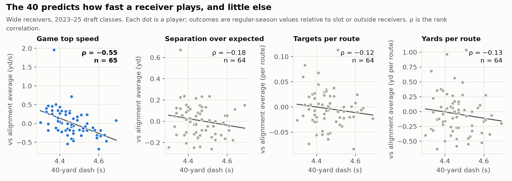
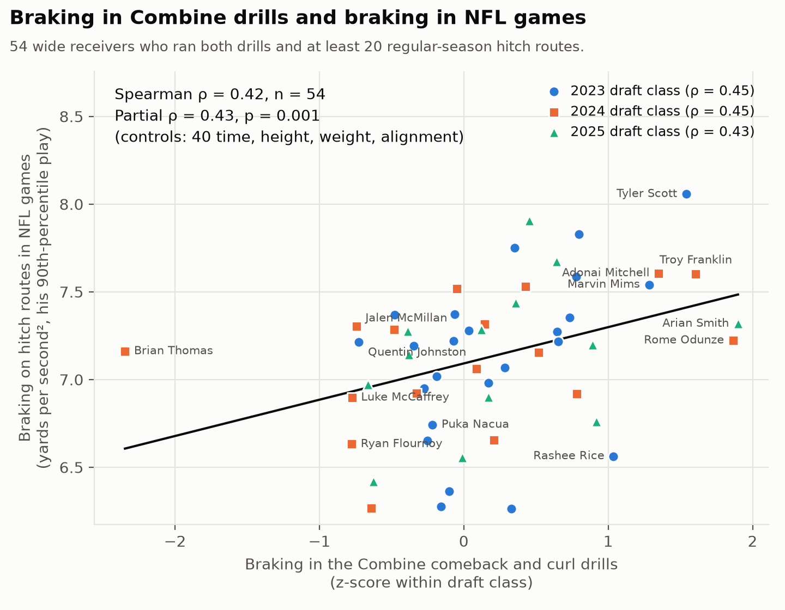
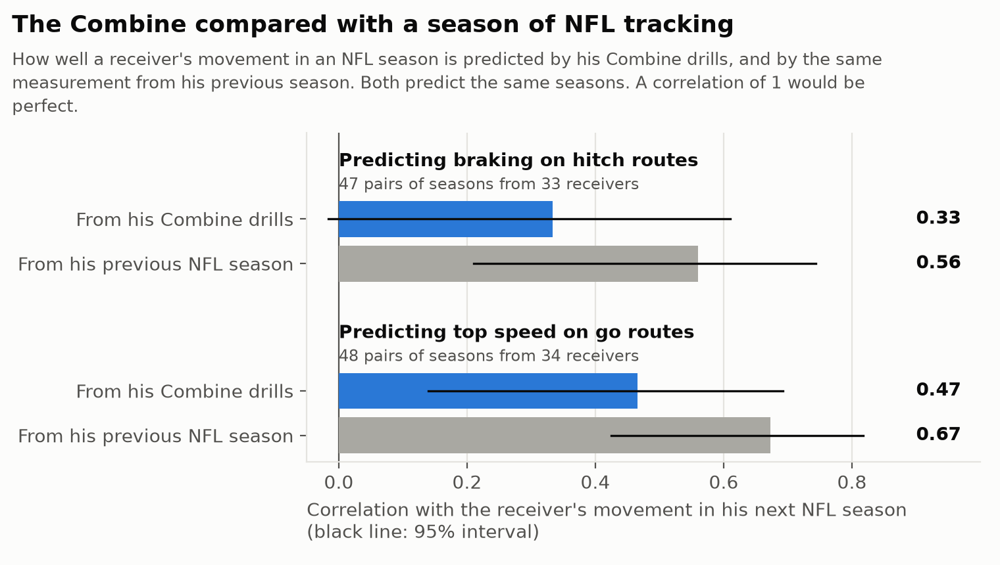
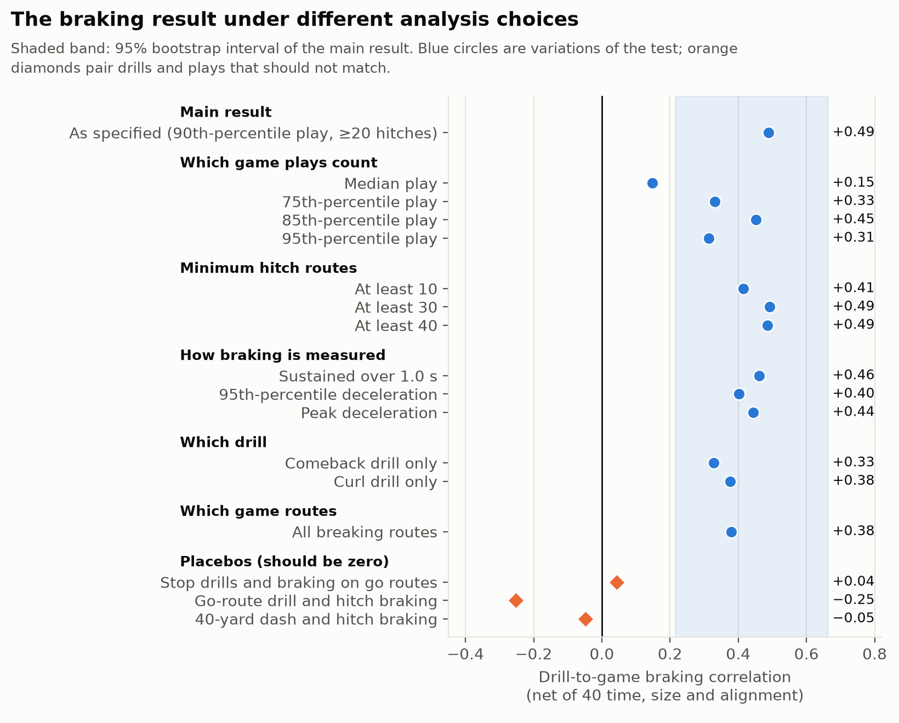
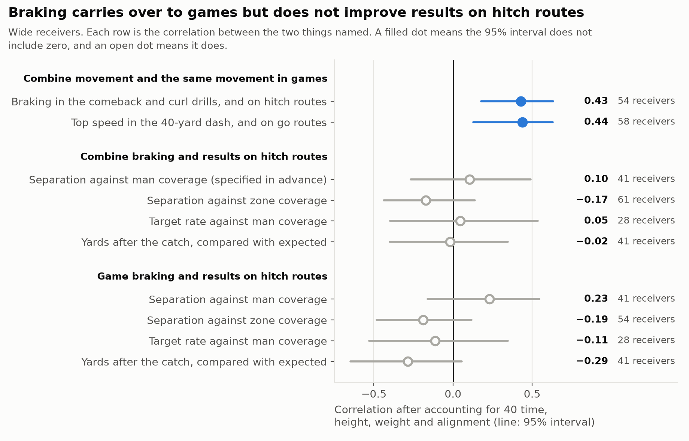

# Brakes travel, separation doesn't follow

**What Combine tracking tells you about a receiver's Sundays, and what it can't.**

## The short version

We measured how hard wide receivers brake in the Combine's comeback and curl drills, using the 10 Hz sensor tracking, and then measured the same thing, the same way, on their hitch routes in regular-season NFL games.

- **The movement transfers.** Receivers who brake hardest in Indianapolis brake hardest on Sundays (rank correlation 0.48 across 54 receivers; 0.49 after removing 40 time, size and alignment). It holds in each of the three draft classes.
- **The drill is nearly as informative as a season of NFL tracking.** A receiver's previous NFL season predicts his braking the next season at 0.56. The Combine drill, run once, before he is drafted, gets 0.48.
- **The stopwatch does not capture it.** Removing 40 time, height and weight leaves the relationship unchanged.
- **But braking does not buy separation.** In a test we wrote down and committed before running it, drill braking did not predict hitch separation against man coverage (0.07). Braking measured in games does not predict it either.

So Combine tracking is a valid early read on how a receiver moves, and that read should be used to describe his movement, not to forecast his separation.

## Why look past the stopwatch

The 40 is the Combine's signature number, so we started by asking what it predicts for receivers once they are in the league. We compared each standard Combine measurement with regular-season outcomes for the 2023–2025 draft classes, with every outcome taken relative to the average for the receiver's usual alignment (slot or outside), because the two jobs differ.

A faster 40 means a faster receiver in games (−0.55, and it survives correction for every test we ran on receivers). It says little about separation (−0.18), targets per route (−0.12) or yards per route (−0.13). The measurement most related to separation is body weight: heavier receivers separate less (−0.51). Draft slot predicts targets (−0.41) and yards per route (−0.40) but not separation (+0.16).

The stopwatch measures one thing, straight-line speed, and that thing shows up on Sundays. The tracking sensors record everything else a receiver does in a drill. The question is whether any of it shows up too.

## Measuring the same thing twice

Most attempts to link the Combine to the NFL compare a drill number with a loosely related game statistic. We did that first, and found nothing. What worked was stricter: **measure one movement trait identically in the drill and in the game situation that drill rehearses.**

- **In the drill.** From each 10 Hz trace we compute the receiver's hardest sustained deceleration over half a second. We take the median over his attempts and express it relative to his own draft class and drill, because drill setups change from year to year. Comeback and curl drills are averaged.
- **In games.** We compute the identical quantity on every regular-season hitch route from the game tracking, starting at the snap. A receiver's game value is his 90th-percentile play: most hitches do not demand a full-effort stop, so the typical play says little about what he can do.
- **Controls.** We report the correlation after removing 40 time, height, weight and alignment, so a result means the tracking says something the stopwatch and tape measure do not.

We set up 29 such drill-to-game pairs across receivers, linemen and defensive backs. Two survive false-discovery correction across all 29, and both are for receivers.

## Brakes travel

Drill braking and game braking correlate at 0.48, and at 0.49 after the controls (bootstrap 95% interval 0.22 to 0.66; permutation p = 0.0005; false-discovery q = 0.005). The by-class correlations are 0.55, 0.45 and 0.43.

The second survivor is speed: top speed in the tracked 40 predicts top speed on go routes at 0.44 *after* removing the official 40 time (q = 0.009). The sensor's peak-speed reading carries information the official time does not.

How good is 0.48? The natural yardstick is the best information a team will ever have: the same measurement from the player's own previous NFL season.

A season of NFL hitch routes predicts the next season's braking at 0.56. Two Combine drills predict it at 0.48, with overlapping intervals. For top speed the figures are 0.67 and 0.55. The Combine is not a noisy preview of a receiver's movement. It is most of the way to a season of game data, a year earlier.

### Is it real?

We ran the pair under every variation we could think of, plus three placebos.

- **It is specific.** Stop-drill braking does not predict braking on go routes (0.04). Braking measured in the go-route drill (−0.25) or in the 40-yard dash (−0.05) does not predict hitch braking. The match between drill and route matters.
- **It does not depend on the definition.** Three other braking measures, either drill alone, and different play minimums all land between 0.33 and 0.49.
- **It does depend on using a receiver's best plays.** With his median hitch the correlation falls to 0.15. Capability shows at the top of the distribution.

Two honest limits. A tight-end version, using a different drill, did not replicate (23 players). And other receiver traits we expected to transfer, such as re-acceleration out of the break and speed carried through cuts, did not.

## Separation doesn't follow

If a receiver stops faster, the defender should be left further behind. We tested that, expecting it to work.

Our first attempt pooled all hitch routes and found nothing. A fair objection is that against zone the defender is sitting on the route however the receiver stops, so any effect should be against man. We therefore wrote one test down in full (players, plays, outcome, statistic, expected sign), committed it to the repository, and then ran it.

The pre-specified test is null: drill braking against cushion-adjusted hitch separation versus man coverage is 0.07 (p = 0.68, 41 receivers). Target rate and yards after catch over expected show nothing either.

The lower block of the figure is what makes this informative. Braking measured **in games** does not predict hitch separation either. We widened that check to eight in-game movement measures across four route groups, against separation and yards per route: of 64 tests, two pass false-discovery correction, one resting on 17 players and the other pointing the wrong way (harder braking overall, *less* separation). Separation is not noise; a receiver's separation is a stable attribute (split-half reliability 0.69). It is simply not driven by how hard he can stop, cut or accelerate, at least not as tracking of the receiver alone can measure it.

The break in the chain is therefore not at the Combine. It sits between movement and outcome. Separation on a hitch likely depends on things this data cannot see: the defender's leverage and technique, route depth and timing, and the quarterback's decision.

## What a team can do with this

1. **Treat Combine tracking as a year-zero movement profile.** For braking and top speed, the drill tells you most of what a season of game tracking will. A team that builds movement profiles from NFL tracking can start a rookie's profile from his Combine data instead of waiting.
2. **Use it for fit and development, not as a production forecast.** A receiver who cannot decelerate in the curl drill will not suddenly do so on Sundays. That matters for which routes he is asked to run and what a position coach works on. It does not tell you he will get open.
3. **Read the sensor's top speed, not only the 40 time.** It adds to the official time for predicting game speed.
4. **Do not grade separation off Combine movement.** Nothing we measured, in drills or in games, predicts it. Size does.

## Everything else we tested

The result above is one success among many attempts. The notebook reproduces 5,809 statistical tests, and we ran several hundred more exploratory checks along the way. The table lists the families.

| What we tested | Tests | Result |
|---|---|---|
| Standard Combine numbers and 11 planned interactions vs outcomes, five positions | 518 | 40 → game speed; receiver weight → separation |
| Matched drill-to-game transfer, four positions | 29 | Receiver braking and top speed survive; nothing for linemen or defensive backs after size and alignment |
| Robustness and placebos for the braking pair | 17 | Stable; placebos null |
| Does braking, or any game movement, buy results? | 72 | Null, including the pre-specified test |
| Do drill traits predict route or alignment usage? | 17 | Null |
| Every pairwise interaction of Combine numbers and drill traits | 4,589 | Two pass correction; neither holds up on inspection |
| Does a position improve from season 1 to 2 or 3, and does the Combine predict who? | 567 | Nothing passes correction |

One lead from that last family is worth watching with the 2026 class. Defensive linemen who recorded no snaps in their second season had much lower burst in the Combine pass-rush drill than those who played (0.7 standard deviations lower, p = 0.007), with the same pattern in season three. It came out of a scan of 538 tests and does not pass correction, so we report it as a lead only.

We also trained two contrastive neural networks to match players across drills and games. They found a repeatable movement signature but predicted no outcome, and are left to the notebook appendix.

## Limits

- **Small samples.** 54 receivers carry the headline. The interval on 0.49 runs from 0.22 to 0.66.
- **No holdout remains.** All three draft classes were used in the search. The matched design was not our first design, so the braking result should be confirmed on the 2026 class before anyone relies on it. The man-coverage test is the only one pre-specified.
- **Survivors only.** A receiver needs 20 NFL hitch routes to be measured, so players who never earned snaps are absent.
- **One player at a time.** Game tracking here covers only the drafted players, not defenders or the ball. Separation and cushion come from the provided play-level columns.

## Code

The attached notebook goes from the competition CSVs to every number and figure above in about ten minutes, calling a small Python package that holds the analysis.
