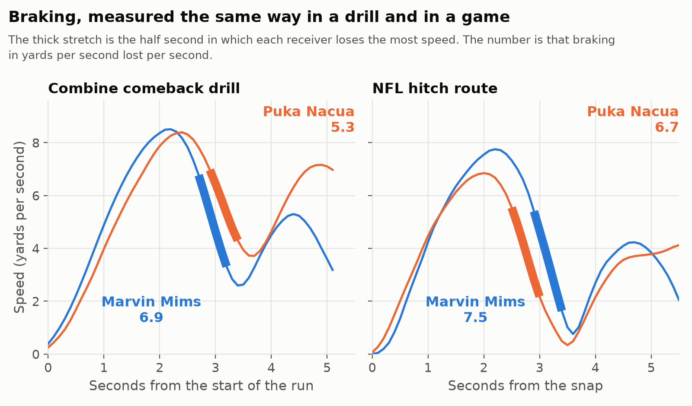

# Predicting How Receivers Move: Combine Drills Against a Season of NFL Tracking

## Summary

Two Combine drills predict how hard a wide receiver brakes on hitch routes in NFL games, at a correlation of 0.42 across his career. A season of his own NFL tracking is a better guide. Predicting the same NFL seasons, the drills reach 0.33 and the previous season reaches 0.56. For top speed, the tracked 40-yard dash reaches 0.47 and a previous season 0.67. The drills give a team a partial read on how a receiver moves before he plays a snap, and once a season of game tracking exists they add nothing to it.

- I measure braking from the Combine's 10 Hz tracking in the comeback and curl drills, and in the same way on hitch routes in regular-season games.
- Receivers who brake harder in the drills also brake harder in games. The rank correlation is 0.42 across 54 receivers, and 0.43 after I account for 40 time, height, weight and alignment.
- Braking does not predict separation. I wrote that test down and committed it before I ran it, and the correlation against man coverage came out at 0.10. Braking measured in games does not predict separation either.

I would use these measurements to judge how a receiver fits a route tree and to plan his development, and I would not use them to forecast how open he will get.

## Measuring braking the same way in the drill and in the game

My first approach, comparing drill measurements with related game statistics, found nothing. The approach that worked was to measure one movement trait in exactly the same way in a drill and in the game situation that the drill rehearses.

In the drill, I take each 10 Hz trace and compute the receiver's hardest sustained deceleration over half a second. I use the median across his attempts and express it relative to his own draft class and drill, since drill setups change from year to year. I then average the comeback and curl drills. I drop clips that last less than 65% of the usual time for their drill, which removes 29 of 6,307, because they end before the receiver has stopped.

In games, I compute the same quantity on every regular-season hitch route, starting at the snap, for the 2023, 2024 and 2025 draft classes. For each receiver I use his 90th-percentile play, because most hitch routes do not require a full-effort stop and a typical play says little about how hard he is able to brake.

The figure shows the measurement for two receivers from the 2023 class. Marvin Mims ranks 6th of 54 for braking in the drills and 9th in games, and Puka Nacua ranks 38th and 44th. Each game route shown is the one closest to that receiver's 90th percentile.

I report each correlation after removing the effects of 40 time, height, weight and alignment, so a result that survives reflects something the standard measurements miss.

I set up 29 of these drill-to-game pairs across receivers, offensive and defensive linemen, and defensive backs. Two survive false-discovery correction across all 29, and both involve receivers. They are braking and top speed, where a receiver's peak speed in the tracked 40 is paired with his top speed on go routes.

## The Combine compared with a season of NFL tracking

To judge how strong these relationships are, I compared each with the same measurement from the receiver's previous NFL season. Both predict the same target, his braking or top speed in one NFL season, across 47 pairs of consecutive seasons from 33 receivers (48 from 34 for top speed).

The previous season predicts braking at 0.56 and the Combine drills at 0.33. For top speed the numbers are 0.67 and 0.47. In variance explained, the Combine gives about a third of what a season gives for braking and about half for top speed. The intervals overlap, as only 33 receivers have two seasons. Once a season is known, the drills add nothing (0.10, p = 0.58). The drills are a pre-draft stand-in for game tracking.

Part of the gap is noise in the drills. The comeback and curl drills agree with each other at only 0.26, so more repetitions per drill would likely sharpen the read.

## Braking carries over receiver by receiver

Drill braking and game braking correlate at 0.42, or 0.43 after the controls. The bootstrap 95% interval is 0.18 to 0.63, the permutation p-value is 0.005, and the false-discovery q-value is 0.018. Within the 2023, 2024 and 2025 classes the correlations are 0.45, 0.45 and 0.43.

| Receiver | Draft | Drill rank | Game rank (of 54) |
|---|---|---|---|
| Arian Smith | 2025, pick 110 | 1 | 16 |
| Rome Odunze | 2024, pick 9 | 2 | 24 |
| Troy Franklin | 2024, pick 102 | 3 | 7 |
| Tyler Scott | 2023, pick 133 | 4 | 1 |
| Adonai Mitchell | 2024, pick 52 | 5 | 6 |
| Quentin Johnston | 2023, pick 21 | 50 | 27 |
| Jalen McMillan | 2024, pick 92 | 51 | 18 |
| Luke McCaffrey | 2024, pick 100 | 52 | 42 |
| Ryan Flournoy | 2024, pick 216 | 53 | 47 |
| Brian Thomas | 2024, pick 23 | 54 | 30 |

The table lists the five hardest and five softest brakers in the drills. All five of the hardest are in the top half for game braking, and three of the five softest are in the bottom half. The relationship has clear misses. Rashee Rice ranked 7th in the drills and 48th in games across 141 hitch routes. Brian Thomas had the softest drill braking by a wide margin and sits near the middle in games.

### Checking the result

I reran the braking comparison under different analysis choices and added three placebo comparisons that should show no relationship.

The result is specific to matching drills and routes. Braking in the stop drills does not predict braking on go routes (0.07), and braking measured in the go-route drill (−0.25) or the 40-yard dash (−0.05) does not predict braking on hitch routes.

The result holds across definitions. Three other ways of measuring braking, each drill on its own, and different minimum play counts all give correlations between 0.33 and 0.43. If I keep the clips that were cut off early, the correlation is 0.49, so those clips had been flattering the result.

It does depend on using a receiver's hardest plays. When I use his median hitch route, the correlation drops to 0.18.

Two extensions did not work. A version for tight ends using a different drill did not replicate, although it only had 23 players. Other receiver traits that I expected to carry over, including re-acceleration out of the break and speed carried through cuts, did not.

## What the sensors add to the stopwatch

I also checked what the standard Combine numbers predict for receivers. Because slot and outside receivers have different jobs, I measured every outcome relative to the average for the receiver's usual alignment.

A faster 40 goes with a higher top speed in games (−0.55), and that relationship holds up after correcting for every test I ran on receivers. The 40 has much weaker relationships with separation (−0.18), targets per route (−0.12) and yards per route (−0.13). The measurement most related to separation is body weight, where heavier receivers separate less (−0.51).

The sensors add to the official time in two ways. The tracked 40's peak speed predicts top speed on go routes at 0.44 after I remove the official 40 time (q = 0.017), so it carries information the official time leaves out. Braking is almost unrelated to top speed across receivers (−0.13, 91 receivers), so it describes a second part of how a receiver moves that the 40 does not cover. It is also unrelated to the two stopwatch drills that involve stopping, the 3-cone (−0.03, 32 receivers) and the short shuttle (−0.08, 36). Too few of the 54 ran those drills to use them as controls.

## What the measurements should and should not be used for

The most direct use is judging fit with a route tree. An offence built on timing throws to hitches, curls and comebacks asks its receivers to stop hard on a large share of their routes, and the drills show which prospects are able to do that. An offence built on vertical routes can give more weight to the sensor's top speed. A position coach can use the same reading to plan a rookie's development.

I expected a receiver who stops faster to leave his defender further behind, so I also tested whether braking predicts separation. My first test pooled all hitch routes and found nothing. Against zone coverage the defender is already sitting on the route regardless of how the receiver stops, so any effect should be clearer against man coverage. I wrote out a single test in full, including the players, plays, outcome, statistic and expected direction, committed it to the repository, and only then ran it.

The pre-specified test found no relationship. The correlation between drill braking and cushion-adjusted hitch separation against man coverage is 0.10 (p = 0.52, 41 receivers). Target rate and yards after catch over expected show no relationship either.

Braking measured in games does not predict hitch separation either, as the bottom section of the figure shows. I extended that check to eight in-game movement measures across four groups of routes, tested against both separation and yards per route. Of those 64 tests, two pass false-discovery correction. One rests on 17 players, and the other runs opposite to what I expected. Separation is a stable trait for a receiver, with a split-half reliability of 0.69, so these results cannot be put down to a noisy outcome.

I also compared braking and top speed with separation against man and zone overall, and against Cover 1, Cover 2, Cover 3 and Cover 4 or 6. None of those 12 tests showed a relationship, and the largest correlation was 0.15.

The Combine measurement is therefore doing its job, and the weak link is between movement and separation. Separation probably depends on things this dataset does not include, such as the defender's leverage and technique and the timing of the route. A team with tracking for every player could measure the cornerback's braking on the same plays and test whether the gap between the two players predicts separation better than the receiver's braking does alone. I think that is the most useful open question here.

## Everything else I tested

The braking result is one positive finding out of many attempts. The notebook reproduces 5,825 statistical tests, and I estimate that I ran several hundred more while developing the analysis.

| What I tested | Tests | Result |
|---|---|---|
| Standard Combine numbers and 11 planned interactions against outcomes, five positions | 518 | 40 time predicts game speed; receiver weight predicts separation |
| Matched drill-to-game comparisons, four positions | 29 | Receiver braking and top speed survive; nothing for linemen or defensive backs after controlling for size and alignment |
| Variations and placebos for the braking comparison | 18 | Stable; placebos show no relationship |
| Whether braking, top speed or any in-game movement predicts results, including by coverage | 84 | No relationship, including the pre-specified test |
| Whether drill traits predict route or alignment usage | 17 | No relationship |
| Every pairwise interaction of Combine numbers and drill traits | 4,589 | Two pass correction, and neither holds up on closer inspection |
| Whether a position improves from season 1 to season 2 or 3, and whether the Combine predicts who improves | 567 | Nothing passes correction |

I also trained two neural networks to match players across drills and games. They did not predict any outcome and are in the notebook appendix.

## Limitations

- The samples are small. The main result rests on 54 receivers.
- There is no holdout class left. I used all three draft classes while searching, so the braking result should be confirmed on the 2026 class before anyone relies on it. The man-coverage test is the only one I specified in advance.
- The sample only includes receivers who ran at least 20 hitch routes in NFL games, so players who rarely played are missing.
- The game tracking covers only the drafted players, so separation and cushion come from the play-level columns provided with the data.

## Code

The attached notebook reproduces every number and figure in this writeup from the competition CSVs in about ten minutes.
